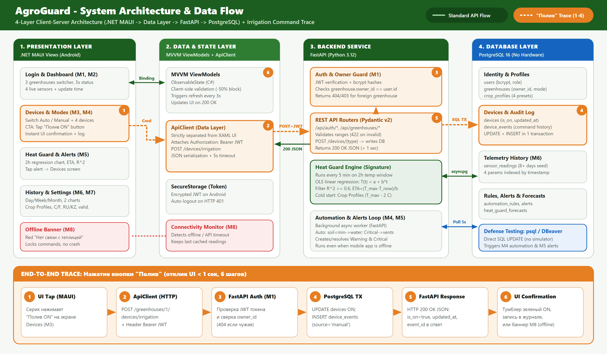

# System Architecture & Tech Stack - AgroGuard

**Owner:** Artur Kurmashev (Team Lead / Backend Developer)  
**Stage:** Week 2 - Design  
**Stack:** .NET MAUI (C#, XAML, MVVM, Android) + FastAPI (Python 3.12, Pydantic v2, SQLAlchemy 2.0) + PostgreSQL 16

---

## 1. Architecture Diagram



*Vector source:* [architecture.svg](assets/architecture.svg)

---

## 2. Four Architectural Layers

### Layer 1: Presentation Layer (.NET MAUI Views, Android)
- Native Android mobile app built with XAML screens (`LoginPage`, `DashboardPage`, `HeatGuardPage`, `DevicesPage`, `AlertsPage`, `HistoryPage`, `SettingsPage`).
- Contains **zero SQL or HTTP code**: views bind purely to ViewModel properties and commands (`CommunityToolkit.Mvvm`).
- Designed for outdoor readability under Atyrau sun (`#F6F8F5` background, `#1B5E20` accents, `>= 48 dp` controls).

### Layer 2: Client State & Data Layer (MVVM ViewModels + `ApiClient`)
- **ViewModels:** hold observable screen state, run instant client-side validation (e.g., blocking `-50%` humidity before hitting the network), and poll live readings every 3 seconds.
- **`ApiClient` (Data Layer):** single HTTP gateway wrapping `HttpClient`. Automatically injects `Authorization: Bearer <JWT>` from Android `SecureStorage`, enforces a 5-second timeout, and maps JSON DTOs.
- **Connectivity Monitor (M8):** catches network drop / server timeout without crashing, switches UI to the red `"Нет связи с теплицей"` banner, preserves last cached readings, and locks command buttons until reconnection.

### Layer 3: Backend Service (FastAPI, Python 3.12)
- **Auth & Owner Isolation (M1):** bcrypt password hashing + signed JWT tokens. Every `/api/greenhouses/{id}/*` route verifies `greenhouse.owner_id == current_user.id` and returns `404` for another farmer's greenhouse.
- **REST Routers + Pydantic v2:** strict server-side validation (`422 Unprocessable Entity` on invalid thresholds, `min >= max`, or out-of-range humidity).
- **Heat Guard Engine (Signature Feature):** every 5 minutes queries the last 2 hours of `sensor_readings` (~24 points), fits OLS linear regression `T(t) = a + b*t`, filters noise via `R^2 >= 0.6`, calculates `ETA = (T_max - T_now) / b`, and saves the result to `heat_guard_forecasts`. When a greenhouse has < 2 hours of data (cold start), falls back to **Learning mode** using the selected Crop Profile (`warning at T_max - 2 C`).
- **Automation & Alerts Loop (M4, M5):** async background worker running on the server even when the farmer's phone is offline. In `auto` mode triggers watering (with `auto_off_at` timer) or preventive ventilation (`ETA < 30 min`) and automatically creates/resolves alerts.

### Layer 4: Persistence Layer (PostgreSQL 16)
- Relational database with 9 normalized tables (`users`, `greenhouses`, `crop_profiles`, `sensor_readings`, `devices`, `device_events`, `automation_rules`, `alerts`, `heat_guard_forecasts`).
- **No hardware / no external simulator:** `sensor_readings` is seeded with 8+ days of realistic telemetry, and alerts/automation are demonstrated during defense via direct `SQL UPDATE` / `INSERT` commands in `psql` or `DBeaver`.

---

## 3. End-to-End Trace: Pressing the "Полив" (Irrigation) Button

Target response time from finger tap to visual confirmation: **< 1 second**.

1. **UI Tap (MAUI `DevicesPage`):** Serik taps the `OFF -> ON` toggle on `"Полив (капельный)"` for Greenhouse 1 (`id = 1`).
2. **Data Layer (`DevicesViewModel` -> `ApiClient`):** ViewModel disables double-tap and calls `ApiClient.SetDeviceStateAsync(greenhouseId: 1, deviceType: "irrigation", isOn: true)`, which sends:
   ```http
   POST /api/greenhouses/1/devices/irrigation
   Authorization: Bearer <JWT>
   Content-Type: application/json

   {"is_on": true, "duration_minutes": 10}
   ```
3. **Auth & Ownership Guard (FastAPI):** Middleware decodes the JWT (`user_id = 1`, Serik), queries `greenhouses WHERE id = 1 AND owner_id = 1`. If missing or owned by another user, immediately returns `404 Not Found` (M1 isolation).
4. **Atomic PostgreSQL Transaction (`asyncpg` + SQLAlchemy):**
   - `UPDATE devices SET is_on = TRUE, auto_off_at = NOW() + INTERVAL '10 minutes', updated_at = NOW() WHERE greenhouse_id = 1 AND device_type = 'irrigation';`
   - `INSERT INTO device_events (device_id, greenhouse_id, triggered_by_user_id, new_state, source, note) VALUES (..., TRUE, 'manual', 'Watering started for 10 min');`
5. **FastAPI JSON Response:** Commits the transaction and returns `HTTP 200 OK` with updated device state, `auto_off_at`, `updated_at`, and the new `event_id`.
6. **UI Confirmation (or M8 Failure Handling):** `DevicesViewModel` flips the toggle to green `ON`, prepends the entry to the command log (`device_events`), and shows confirmation toast. If the server is unreachable or times out, `ApiClient` catches the exception, reverts the toggle, and displays the red `"Нет связи с теплицей"` banner (M8) without crashing.

---

## 4. Technology Stack Justification (and Why Not Flutter + Firebase)

| Technology | Why We Chose It for AgroGuard |
|---|---|
| **.NET MAUI (C#, XAML, MVVM)** | Native Android UI performance, strong C# typing shared across team coursework, clean built-in MVVM separation from `ApiClient`, and native `GraphicsView` canvas for History and Heat Guard charts. |
| **FastAPI (Python 3.12)** | Async REST performance, automatic OpenAPI/Swagger docs for fast mobile integration, strict Pydantic v2 validation (M7), and ideal Python ecosystem for writing the Heat Guard linear regression math and background automation loop cleanly. |
| **PostgreSQL 16** | True relational integrity (`owner_id` FK isolation, `CHECK` constraints blocking bad values at DB level), indexed time-series queries over 8+ days of `sensor_readings`, and direct SQL testing via `psql` / `DBeaver` during defense without any hardware simulator. |
| **JWT + bcrypt** | Stateless, industry-standard mobile authentication; passwords are never stored in plain text, and tokens live in Android `SecureStorage`. |

### Why NOT Flutter + Firebase?
1. **Relational integrity & DB-console defense:** Course testing requires demonstrating isolation, history queries, and triggering alerts directly in a SQL database console (`psql` / `DBeaver`). Firebase Firestore is NoSQL document storage without native SQL `CHECK` constraints, joins, or transactional `UPDATE + INSERT` audit logs.
2. **Server-side background automation & Heat Guard:** Heat Guard must run 2-hour OLS linear regression every 5 minutes and open ventilation automatically even when Serik's phone is offline. With FastAPI + PostgreSQL this runs inside one predictable backend service; in Firebase it would require paid Cloud Functions (Blaze billing plan) and complex workarounds.
3. **Zero vendor lock-in & local reproducibility:** FastAPI + PostgreSQL runs 100% locally on any laptop during college defense with zero cloud quota or internet dependency.
4. **Team expertise:** Our group already has strong C# and Python foundations; `.NET MAUI + FastAPI` lets us build higher-quality features faster than learning Dart/Flutter from scratch.
