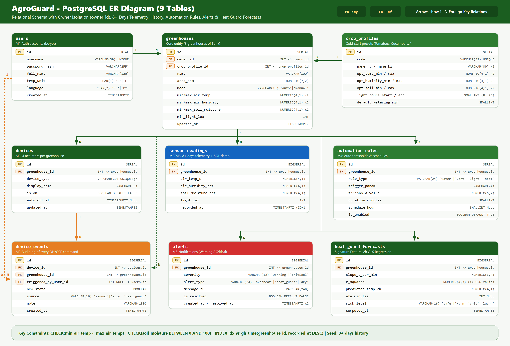

# PostgreSQL Database Schema & SQL Logic - AgroGuard

**Owner:** Nurdaulet Zhumabay (Database & Automation Engineer)  
**DBMS:** PostgreSQL 16  
**Simulator Policy:** No external hardware or simulator is used. All readings live in PostgreSQL (`sensor_readings`, seeded with 8+ days of realistic data), and alerts / automation are tested directly via SQL in `psql` or `DBeaver`.

---

## 1. Entity-Relationship Diagram (9 Tables)



*Vector source:* [er_diagram.svg](assets/er_diagram.svg)

---

## 2. Table Specifications

### 2.1 `users` (M1 Authentication & Preferences)
Stores farmer accounts with bcrypt password hashes and personal display preferences.

| Column | Type | Constraints | Description |
|---|---|---|---|
| `id` | `SERIAL` | `PRIMARY KEY` | Farmer unique ID |
| `username` | `VARCHAR(50)` | `UNIQUE NOT NULL` | Login name (e.g. `serik.abenov`) |
| `password_hash` | `VARCHAR(255)` | `NOT NULL` | bcrypt hash (never plain text) |
| `full_name` | `VARCHAR(120)` | `NOT NULL` | Display name (`Серик Абенов`) |
| `temp_unit` | `CHAR(1)` | `NOT NULL DEFAULT 'C' CHECK (temp_unit IN ('C','F'))` | Temperature display unit (M7) |
| `language` | `CHAR(2)` | `NOT NULL DEFAULT 'ru' CHECK (language IN ('ru','kz'))` | UI language (M7) |
| `created_at` | `TIMESTAMPTZ` | `NOT NULL DEFAULT NOW()` | Account creation time |

### 2.2 `crop_profiles` (Cold-Start Presets)
Built-in agronomic profiles solving the cold-start problem for new greenhouses: **Tomatoes, Cucumbers, Strawberries, Greens**.

| Column | Type | Constraints | Description |
|---|---|---|---|
| `id` | `SERIAL` | `PRIMARY KEY` | Profile ID |
| `code` | `VARCHAR(32)` | `UNIQUE NOT NULL` | `tomatoes`, `cucumbers`, `strawberries`, `greens` |
| `name_ru` / `name_kz` | `VARCHAR(80)` | `NOT NULL` | Localized crop name |
| `opt_temp_min` / `opt_temp_max` | `NUMERIC(4,1)` | `NOT NULL, CHECK (min < max)` | Optimal air temperature (C) |
| `opt_humidity_min` / `opt_humidity_max` | `NUMERIC(4,1)` | `NOT NULL, CHECK (0..100)` | Optimal air humidity (%) |
| `opt_soil_min` / `opt_soil_max` | `NUMERIC(4,1)` | `NOT NULL, CHECK (0..100)` | Optimal soil moisture (%) |
| `light_hours_start` / `light_hours_end` | `SMALLINT` | `NOT NULL, CHECK (0..23)` | Default phyto-lamp schedule |
| `default_watering_min` | `SMALLINT` | `NOT NULL CHECK (1..60)` | Default irrigation duration (min) |

### 2.3 `greenhouses` (Core Multi-Greenhouse Entity)
Every greenhouse is bound to `owner_id` so one farmer can never access another farmer's data (M1).

| Column | Type | Constraints | Description |
|---|---|---|---|
| `id` | `SERIAL` | `PRIMARY KEY` | Greenhouse ID |
| `owner_id` | `INT` | `NOT NULL REFERENCES users(id) ON DELETE CASCADE` | Account isolation key (M1) |
| `crop_profile_id` | `INT` | `REFERENCES crop_profiles(id)` | Active preset (cold start) |
| `name` | `VARCHAR(100)` | `NOT NULL` | e.g. `Теплица 1`, `Теплица 2`, `Теплица 3` |
| `area_sqm` | `NUMERIC(7,2)` | `NOT NULL CHECK (area_sqm > 0)` | Area in m2 (e.g. `500.00`) |
| `mode` | `VARCHAR(10)` | `NOT NULL DEFAULT 'auto' CHECK (mode IN ('auto','manual'))` | Operating mode (M4) |
| `min_air_temp` / `max_air_temp` | `NUMERIC(4,1)` | `NOT NULL CHECK (min < max)` | Custom temp range (C) |
| `min_air_humidity` / `max_air_humidity` | `NUMERIC(4,1)` | `NOT NULL CHECK (0..100, min < max)` | Custom air humidity range (%) |
| `min_soil_moisture` / `max_soil_moisture` | `NUMERIC(4,1)` | `NOT NULL CHECK (0..100, min < max)` | Custom soil moisture range (%) |
| `min_light_lux` | `INT` | `NOT NULL CHECK (min_light_lux >= 0)` | Minimum light level (lux) |
| `updated_at` | `TIMESTAMPTZ` | `NOT NULL DEFAULT NOW()` | Last settings update |

### 2.4 `sensor_readings` (M2 Live Data, M6 8+ Days History, Heat Guard Input)
Indexed by `(greenhouse_id, recorded_at DESC)` for fast dashboard polling, weekly charts, and 2-hour regression windows.

| Column | Type | Constraints | Description |
|---|---|---|---|
| `id` | `BIGSERIAL` | `PRIMARY KEY` | Reading ID |
| `greenhouse_id` | `INT` | `NOT NULL REFERENCES greenhouses(id) ON DELETE CASCADE` | Target greenhouse |
| `air_temp_c` | `NUMERIC(4,1)` | `NOT NULL` | Air temperature (C) |
| `air_humidity_pct` | `NUMERIC(4,1)` | `NOT NULL CHECK (0..100)` | Air humidity (%) |
| `soil_moisture_pct` | `NUMERIC(4,1)` | `NOT NULL CHECK (0..100)` | Soil moisture (%) |
| `light_lux` | `INT` | `NOT NULL CHECK (light_lux >= 0)` | Illuminance (lux) |
| `recorded_at` | `TIMESTAMPTZ` | `NOT NULL DEFAULT NOW()` | Timestamp (composite index) |

### 2.5 `devices` (M3: 4 Actuators per Greenhouse)
Each greenhouse has exactly 4 rows: `irrigation`, `ventilation`, `lamps`, `heating`.

| Column | Type | Constraints | Description |
|---|---|---|---|
| `id` | `SERIAL` | `PRIMARY KEY` | Device ID |
| `greenhouse_id` | `INT` | `NOT NULL REFERENCES greenhouses(id) ON DELETE CASCADE` | Parent greenhouse |
| `device_type` | `VARCHAR(20)` | `NOT NULL CHECK (IN ('irrigation','ventilation','lamps','heating'))` | Unique per greenhouse |
| `display_name` | `VARCHAR(60)` | `NOT NULL` | Russian UI label |
| `is_on` | `BOOLEAN` | `NOT NULL DEFAULT FALSE` | Current actuator state |
| `auto_off_at` | `TIMESTAMPTZ` | `NULL` | Timer for auto-stopping irrigation |
| `updated_at` | `TIMESTAMPTZ` | `NOT NULL DEFAULT NOW()` | Last toggle timestamp |

### 2.6 `device_events` (M3 Audit Log)
Records every manual, automated, or Heat Guard device command.

| Column | Type | Constraints | Description |
|---|---|---|---|
| `id` | `BIGSERIAL` | `PRIMARY KEY` | Event ID |
| `device_id` | `INT` | `NOT NULL REFERENCES devices(id) ON DELETE CASCADE` | Toggled device |
| `greenhouse_id` | `INT` | `NOT NULL REFERENCES greenhouses(id) ON DELETE CASCADE` | Denormalized for fast greenhouse log query |
| `triggered_by_user_id` | `INT` | `NULL REFERENCES users(id)` | Farmer ID for `manual`, `NULL` for `auto` / `heat_guard` |
| `new_state` | `BOOLEAN` | `NOT NULL` | `TRUE` (ON) or `FALSE` (OFF) |
| `source` | `VARCHAR(16)` | `NOT NULL CHECK (source IN ('manual','auto','heat_guard'))` | Command initiator |
| `note` | `VARCHAR(180)` | `NULL` | Human-readable reason |
| `created_at` | `TIMESTAMPTZ` | `NOT NULL DEFAULT NOW()` | Event timestamp |

### 2.7 `automation_rules` (M4 Auto Rules & Schedules)
Stores per-greenhouse automated triggers (irrigation duration, scheduled watering hour, lighting hours).

| Column | Type | Constraints | Description |
|---|---|---|---|
| `id` | `SERIAL` | `PRIMARY KEY` | Rule ID |
| `greenhouse_id` | `INT` | `NOT NULL REFERENCES greenhouses(id) ON DELETE CASCADE` | Parent greenhouse |
| `rule_type` | `VARCHAR(24)` | `NOT NULL CHECK (IN ('water','vent','light','heat'))` | Action category |
| `trigger_param` | `VARCHAR(24)` | `NOT NULL` | e.g. `soil_moisture_pct`, `air_temp_c`, `schedule` |
| `threshold_value` | `NUMERIC(6,2)` | `NOT NULL` | Trigger threshold |
| `duration_minutes` | `SMALLINT` | `NOT NULL DEFAULT 10` | Duration for timed actions |
| `schedule_hour` | `SMALLINT` | `NULL CHECK (0..23)` | Optional daily schedule hour |
| `is_enabled` | `BOOLEAN` | `NOT NULL DEFAULT TRUE` | Enable/disable flag |

### 2.8 `alerts` (M5 Notifications Lifecycle)
Active and resolved warnings/critical notifications linked to a greenhouse.

| Column | Type | Constraints | Description |
|---|---|---|---|
| `id` | `BIGSERIAL` | `PRIMARY KEY` | Alert ID |
| `greenhouse_id` | `INT` | `NOT NULL REFERENCES greenhouses(id) ON DELETE CASCADE` | Affected greenhouse |
| `severity` | `VARCHAR(12)` | `NOT NULL CHECK (severity IN ('warning','critical'))` | Alert priority |
| `alert_type` | `VARCHAR(24)` | `NOT NULL` | `overheat`, `heat_guard`, `dry_soil`, `low_temp` |
| `message_ru` | `VARCHAR(240)` | `NOT NULL` | Clear Russian text for Serik |
| `is_resolved` | `BOOLEAN` | `NOT NULL DEFAULT FALSE` | Auto-resolved when reading normalizes |
| `created_at` / `resolved_at` | `TIMESTAMPTZ` | `created_at NOT NULL` | Lifecycle timestamps |

### 2.9 `heat_guard_forecasts` (Signature Feature History)
Stores the output of the 5-minute OLS linear regression job for charting and auditability.

| Column | Type | Constraints | Description |
|---|---|---|---|
| `id` | `BIGSERIAL` | `PRIMARY KEY` | Forecast ID |
| `greenhouse_id` | `INT` | `NOT NULL REFERENCES greenhouses(id) ON DELETE CASCADE` | Target greenhouse |
| `slope_c_per_min` | `NUMERIC(6,4)` | `NOT NULL` | Regression slope `b` (C/min) |
| `r_squared` | `NUMERIC(4,3)` | `NOT NULL` | Goodness of fit (`>= 0.6` required) |
| `predicted_temp_2h` | `NUMERIC(4,1)` | `NOT NULL` | Extrapolated temperature at `t_now + 120 min` |
| `eta_minutes` | `INT` | `NULL` | `(T_max - T_now) / b` if rising |
| `risk_level` | `VARCHAR(16)` | `NOT NULL CHECK (IN ('safe','warning','critical','learning'))` | Computed risk status |
| `computed_at` | `TIMESTAMPTZ` | `NOT NULL DEFAULT NOW()` | Job execution time |

---

## 3. SQL Executed When Turning a Device ON ("Полив")

Executed inside a single atomic transaction when FastAPI handles `POST /api/greenhouses/1/devices/irrigation`:

```sql
BEGIN;

UPDATE devices
SET is_on = TRUE,
    auto_off_at = NOW() + INTERVAL '10 minutes',
    updated_at = NOW()
WHERE greenhouse_id = 1
  AND device_type = 'irrigation'
RETURNING id, is_on, auto_off_at, updated_at;

INSERT INTO device_events (
    device_id, greenhouse_id, triggered_by_user_id, new_state, source, note
)
VALUES (
    1, 1, 1, TRUE, 'manual', 'Manual irrigation started from mobile app (10 min)'
)
RETURNING id, created_at;

COMMIT;
```

---

## 4. Defense Demo SQL Queries (`psql` / `DBeaver`, No Simulator)

These queries let the team prove M4 (Auto mode), M5 (Alerts), and Heat Guard live during defense:

```sql
-- 1. Simulate sudden Atyrau heat spike (45.0 C) -> triggers Critical alert (M5) & Auto ventilation (M4)
UPDATE sensor_readings
SET air_temp_c = 45.0, recorded_at = NOW()
WHERE id = (
    SELECT id FROM sensor_readings
    WHERE greenhouse_id = 1
    ORDER BY recorded_at DESC
    LIMIT 1
);

-- 2. Simulate dry soil (20.0%) -> in Auto mode turns irrigation ON for 10 min and logs device_events
UPDATE sensor_readings
SET soil_moisture_pct = 20.0, recorded_at = NOW()
WHERE id = (
    SELECT id FROM sensor_readings
    WHERE greenhouse_id = 1
    ORDER BY recorded_at DESC
    LIMIT 1
);

-- 3. Normalize values -> verifies alerts auto-resolve (is_resolved = TRUE)
UPDATE sensor_readings
SET air_temp_c = 24.5, soil_moisture_pct = 58.0, recorded_at = NOW()
WHERE id = (
    SELECT id FROM sensor_readings
    WHERE greenhouse_id = 1
    ORDER BY recorded_at DESC
    LIMIT 1
);

-- 4. Verify latest device audit log & alerts in DB console
SELECT created_at, device_id, new_state, source, note
FROM device_events
WHERE greenhouse_id = 1
ORDER BY created_at DESC
LIMIT 5;
```
