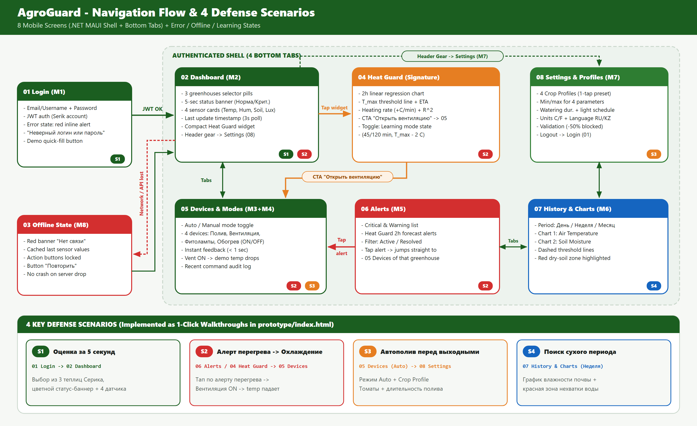

# Navigation Flow & Figma Prototype Guide - AgroGuard

**Owner:** Maxim Li (Mobile Developer - .NET MAUI)  
**Co-author (Screens 04, 06, 07, 08):** Ilnur Garifov  
**Figma Prototype Link:** https://www.figma.com/design/9NNmGFH6OFR9xb7BcEw9Jh/AgroGuard-%E2%80%94-Interactive-UI-Prototype--Maxim-n-Ilnur-?t=3QxbebN2A01O0MHn-0  
**Interactive HTML Prototype:** `prototype/index.html` (frame `390 x 844`, Russian UI)

---

## 1. Navigation Flow Diagram

*Vector source:* [navigation_flow.svg](assets/navigation_flow.svg)

---

## 2. Screen Inventory (8 Screens + Key States)

| # | Screen | File for Figma Import | Module | Owner | Key Elements & States |
|---|---|---|---|---|---|
| **01** | Login | `prototype/screens/01_login.html` | M1 | Maxim Li | AgroGuard logo, username/password fields, JWT info, error state `"Неверный логин или пароль"` |
| **02** | Dashboard | `prototype/screens/02_dashboard.html` | M2 | Maxim Li | 3 greenhouse switcher pills, 5-sec status banner, 4 live sensor cards, last update time, compact Heat Guard widget |
| **03** | Dashboard Offline | `prototype/screens/03_dashboard_offline.html` | M8 | Maxim Li | Red banner `"Нет связи с теплицей"`, dimmed cached values, locked action buttons, `"Повторить"` button |
| **04** | Heat Guard Detail | `prototype/screens/04_heat_guard.html` | Signature | Ilnur Garifov | 2h regression chart, `T_max` line, ETA, heating rate (`+C/min`), `R^2`, CTA `"Открыть вентиляцию"`, toggleable **Learning mode (45/120 min, `T_max - 2 C`)** |
| **05** | Devices & Modes | `prototype/screens/05_devices_modes.html` | M3 + M4 | Maxim Li | `Auto / Manual` toggle, 4 devices (Полив, Вентиляция, Фитолампы, Обогрев) ON/OFF, live cooling feedback, command audit log |
| **06** | Alerts | `prototype/screens/06_alerts.html` | M5 | Ilnur Garifov | Active/Resolved filter, critical overheat & Heat Guard alerts; tapping an alert opens screen `05` for that greenhouse |
| **07** | History & Charts | `prototype/screens/07_history_charts.html` | M6 | Ilnur Garifov | `День / Неделя / Месяц` switch, 2 charts (Air Temp & Soil Moisture) with thresholds and red dry-soil highlight zone |
| **08** | Settings & Crop Profiles | `prototype/screens/08_settings_profiles.html` | M7 | Ilnur Garifov | 4 Crop Profiles (Томаты, Огурцы, Клубника, Зелень), min/max thresholds, watering duration, light schedule, `C/F`, `RU/KZ`, validation blocking `-50%` |

---

## 3. Four Mandatory Defense Scenarios (Click Paths)

All 4 scenarios work both in `prototype/index.html` (via the collapsible top bar) and in Figma:

1. **Scenario 1 - 5-Second Status Check:** `01 Login` -> tap `"Войти"` -> `02 Dashboard` -> inspect colored banner & 4 cards -> switch between `Теплица 1`, `Теплица 2`, `Теплица 3`.
2. **Scenario 2 - Overheat Alert to Cooling:** `06 Alerts` -> tap red overheat card (or `02 Dashboard` -> `04 Heat Guard` -> `"Открыть вентиляцию"`) -> `05 Devices` -> toggle `Вентиляция ON` -> observe live temperature drop from `36.2 C` to `26.8 C`.
3. **Scenario 3 - Auto Watering Before Weekend:** `05 Devices` -> switch mode to `Auto` -> tap header gear icon -> `08 Settings` -> select `Томаты` profile -> set watering duration -> tap `"Сохранить"` (plus demo `-50%` validation block).
4. **Scenario 4 - Weekly Dry Soil Analysis:** Bottom tab `История` -> `07 History & Charts` -> select `Неделя` -> locate the red highlighted dry-soil period (`Ср 14:00 - Чт 09:00, мин. 31%`).

---

## 4. Step-by-Step Guide: Importing Screens into Figma & Linking Prototype

Follow these steps to create the shareable Figma prototype link in under 15 minutes:

1. **Create a new Figma Design File** named `AgroGuard - Week 2 Design (SW 1-24)` and create two pages: `01 Brand & Flows` and `02 Mobile Prototype`.
2. **Import the 8 HTML screens (`390 x 844`):**
   - Install the free Figma plugin **html.to.design** (or **HTML to Figma**).
   - Open `prototype/screens/01_login.html` .. `08_settings_profiles.html` in Google Chrome (or drop them directly into the plugin's local file uploader with viewport `390 x 844`).
   - Arrange frames `01` through `08` left-to-right with `80 px` spacing on page `02 Mobile Prototype`.
   - Duplicate frame `04_heat_guard` to create `04b_heat_guard_learning` (showing the Learning Mode state from `prototype/index.html`).
3. **Import Brand Assets:**
   - Drag `docs/design/assets/logo.svg`, `logo_mark.svg`, `architecture.svg`, `er_diagram.svg`, and `navigation_flow.svg` directly onto page `01 Brand & Flows`.
4. **Wire Clickable Prototype Connections (Prototype tab in Figma):**
   - Set `01_login` as **Flow 1 Starting Point** (Device frame: `iPhone 14 / 390 x 844`).
   - Connect `"Войти"` button on `01` -> `02_dashboard` (Navigate to, Smart Animate `250ms`).
   - Connect compact Heat Guard card on `02` -> `04_heat_guard`; connect `"Открыть вентиляцию"` on `04` -> `05_devices_modes`.
   - Connect bottom tab icons (`Главная`, `Устройства`, `Алерты`, `История`) across `02`, `05`, `06`, `07`.
   - Connect critical alert card on `06_alerts` -> `05_devices_modes`.
   - Connect header gear icon -> `08_settings_profiles`; connect back arrow on `08` -> `02_dashboard`.
   - Connect `"Повторить подключение"` on `03_dashboard_offline` -> `02_dashboard`.
5. **Share & Paste Link:**
   - Click **Share** -> set **Anyone with the link can view** -> click **Copy link**.
   - Published prototype link (also linked in `README.md` and `docs/AgroGuard_Week2_Design.pdf`): https://www.figma.com/design/9NNmGFH6OFR9xb7BcEw9Jh/AgroGuard-%E2%80%94-Interactive-UI-Prototype--Maxim-n-Ilnur-?t=3QxbebN2A01O0MHn-0
